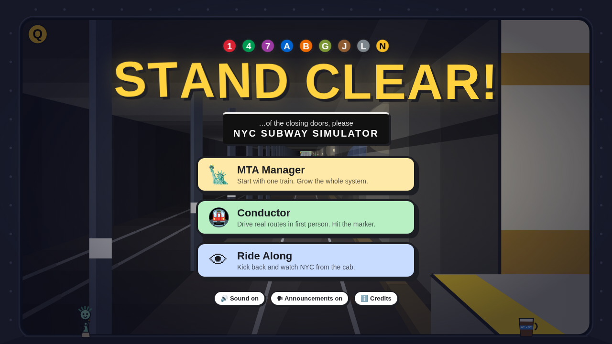
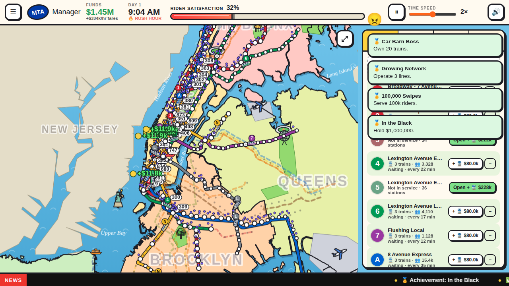
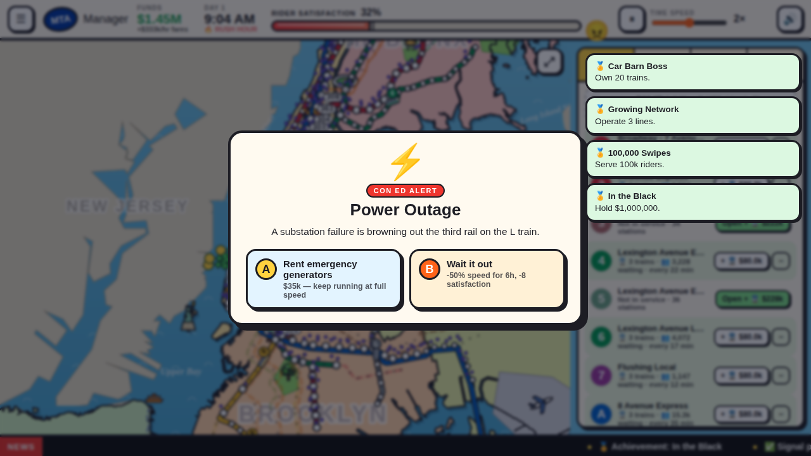
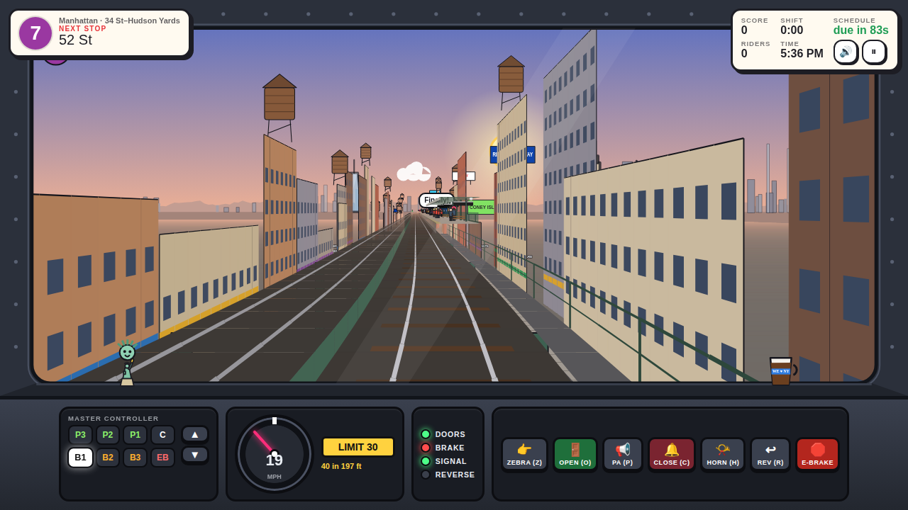
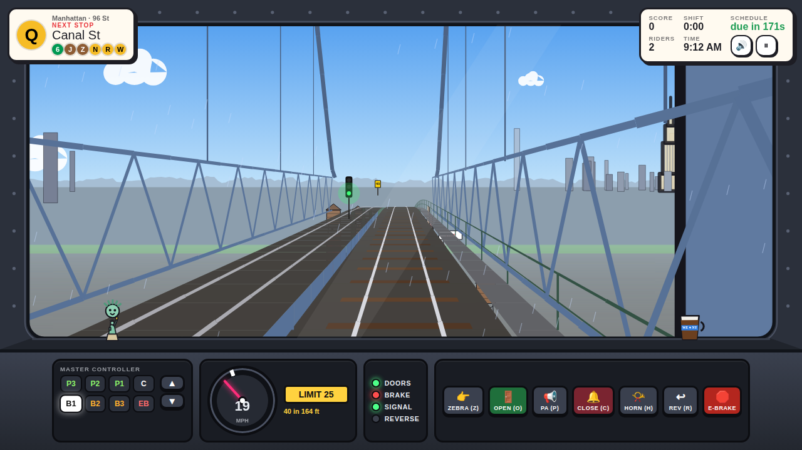
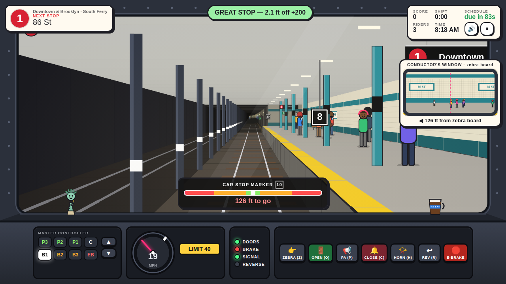

# 🚇 Stand Clear! — NYC Subway Simulator

*…of the closing doors, please.*

A cartoon subway sim set on the **real New York City subway**: real MTA routes, real station order, real track geometry, and real tunnels and elevated structures. You can play it two ways:

- **🗽 MTA Manager.** Albany hands you a cash injection and you put **one train** into service. Riders pay the fare **as they tap through the gate**, and you spend that money on more trains, newer car classes, and upgrades. Delays and incidents hurt rider satisfaction, and every so often you have to make an A-or-B call: budget cuts, crime headlines, Pizza Rat, union talks…
- **🚇 Conductor.** Drive a real route from the cab in first person. Watch the signals and the speed limits, slow for track workers, and stop with your cab lined up on the black **"10" car stop marker**. Open the doors off the platform and a rider can step into the gap. Each station can throw a call at you: fare evaders, door holders, *"It's Showtime!"*, sick passengers…
- **👁 Ride Along / Watch from cab.** Sit back and let the autopilot drive any line. In Manager mode you can click any train and **watch from its cab** while the city keeps running.



| MTA Manager | Decisions |
|---|---|
|  |  |

| 7 train over Queens at sunset | Q over the Manhattan Bridge | Pulling into 86 St on the 1 |
|---|---|---|
|  |  |  |

## ▶️ Play (one click)

**Double-click `index.html`.** That's it. There's no build step, no install and no internet needed. Everything runs in your browser from plain files, and it works straight from disk (`file://`).

If you prefer serving it locally:

```bash
npm start          # http-server on http://localhost:8080
```

To host it, put the repository root on any static host. On GitHub Pages: *Settings → Pages → Deploy from branch → / (root)*.

## 🗽 MTA Manager

- **Start:** you get a **$150,000** injection from Albany. Your first line opening is free, so pick a line (all **26 real routes**, 1 2 3 4 5 6 7 A C E B D F M G J Z L N Q R W, the three S shuttles and the SIR) and buy your first train.
- **Fares at the gate:** riders arrive at stations on the lines you operate. Each one pays the fare (**$2.90**, minus fare evasion) **the moment they tap in**, and green **+$** pops out of the station. Demand follows the real time of day, with morning and evening rush, and busy hubs like Times Sq, Grand Central and Union Sq draw far more riders.
- **Trains** run the real GTFS track geometry. They stop at every station, board and unload riders up to their capacity, turn back at the terminals, and keep their spacing with block signals, so a breakdown makes the trains behind it bunch up.
- **🚃 Fleet:** unlock real MTA car classes in order: **R32 "Brightliner" → R46 → R142A → R160 → R211A → R211T Open Gangway → R262 Next-Gen**. Newer classes carry more riders, run faster, are more comfortable (which raises satisfaction) and break down less. "Replace oldest" trades in old cars.
- **⭐ Upgrades** (5 levels each): OMNY tap readers, station deep cleans, countdown clocks, CBTC signals, track maintenance, a "Take the Train" ad campaign, safety patrols, elevators and accessibility, and Wi-Fi.
- **😀 Satisfaction bar** (top of the screen) drifts toward a target set by wait times, crowding, delays, incidents, riders giving up, train comfort and upgrades. The **Stats** tab breaks down what is behind the number. Happier riders ride more.
- **⚠️ Incidents:** signal problems, breakdowns, sick passengers, police activity and track fires. Click one on the map to send an emergency crew.
- **🃏 Decisions:** every few game hours you make an A-or-B call. There are 25 of them (budget cuts, a fare hike, fare evasion, crime headlines, a heat wave, union talks, naming rights, the Subway Series, a nor'easter…).
- **⏩ Time slider:** pause, ½×, 1×, 2×, 4×, 8× or 16× (keys `0`–`6`, `Space` pauses).
- If you stay **three days in the red**, Albany takes over. The game autosaves; use *Continue* on the title screen.

## 🚇 Conductor controls

| Key | Action |
|---|---|
| `W` / `↑` | Master controller toward power (P1 → P3) |
| `S` / `↓` | Master controller toward brake (B1 → B3) |
| `Space` | Emergency brake |
| `Z` | Point at the **zebra board** (real NYC conductor practice) |
| `O` / `Enter` | Open doors |
| `P` | PA announcement ("Stand clear of the closing doors, please") |
| `C` | Close doors |
| `H` | Horn (honk for track workers!) |
| `R` | Reverse (creep back after an overshoot) |
| `Esc` | Pause |

Every control also has an on-screen button, so it plays on touch screens too.

**Scoring:** a stop within 1 ft of the marker is *perfect*. You also score for being on time, for comfort (don't spill the coffee ☕ on the dash), and for safety and service. You lose points for overspeeding, running a red signal (the trip arm will dump your brakes), blowing through a work zone, skipping a station, and opening the doors off the platform. Each shift pays out and builds your career rank, from *Trainee* up to *Subway Legend*.

## 🗺️ Real data

The map and the routes are built from open data by `tools/build-data.mjs` into `js/data/nyc-data.js` (committed, about 210 KB):

- **MTA subway GTFS static feed:** routes, official route colors, station order (from a representative weekday trip) and track shapes.
- **MTA Subway Stations dataset:** whether each station is underground, elevated, open cut, embankment or viaduct. The first-person track uses this, so the 7 climbs out of the tunnel onto the Flushing el, and the L dives into a round cast-iron tube under the East River.
- **NYC Department of City Planning borough boundaries:** real shorelines.
- **OpenStreetMap land polygons** (© OpenStreetMap contributors, ODbL) for New Jersey, Nassau and Westchester.

Curves in first person follow the real heading changes of the GTFS geometry. River crossings come from testing the real path against the shoreline: the Manhattan and Williamsburg bridges become suspension bridges, and the other water crossings become tubes. The skyline places the Empire State, Chrysler, One WTC and Midtown towers by their **real bearing** from your train.

To refresh the data:

```bash
npm run data:fetch   # downloads the sources from npm/PyPI into .data-src/
npm run data:build   # regenerates js/data/nyc-data.js
```

## 🧱 Project layout

```
index.html            all screens (title, run setup, manager, first-person)
css/style.css         the cartoon UI theme
js/data/nyc-data.js   generated NYC network + shorelines
js/core/              util, procedural audio + speech, UI helpers, network model, landmark icons
js/manager/           content (cars, upgrades, events), simulation, map renderer, screen controller
js/fp/                track builder, sprites, pseudo-3D renderer, stop events, conductor game, screen controller
js/main.js            title screen (live autopilot ride behind the menu), run picker, main loop
tools/                data pipeline + headless economy balance test
```

The art is drawn live on `<canvas>` and the sound is synthesized live with WebAudio, including the two-tone door chime, the stepping "do-re-mi" motor whine, wheel clacks, the horn and brake squeal. Announcements use the browser's speech synthesis. There are no image or audio files.

`npm run balance` runs the real Manager simulation headless with a simple AI policy and prints the economy day by day, which is handy for tuning `js/manager/content.js` and `js/manager/sim.js`.

## Credits

A fan-made game, **not affiliated with or endorsed by the MTA**. Route bullets and colors are used as references to the real system. Map data: MTA, NYC DCP, and © OpenStreetMap contributors (ODbL).
